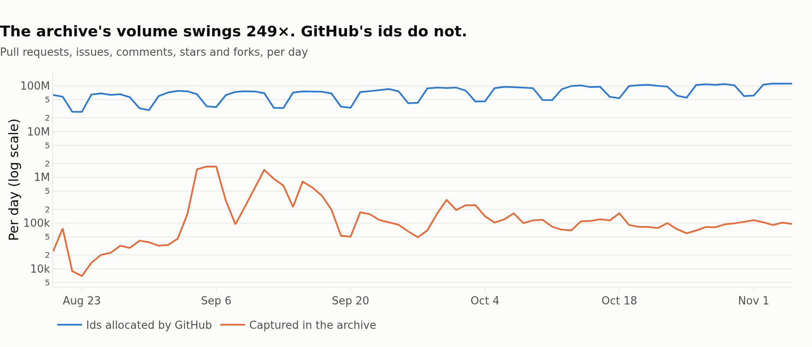
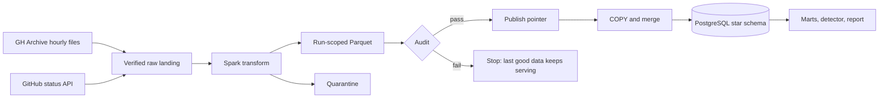

# eventflow

A batch pipeline over [GH Archive](https://www.gharchive.org/), the public record of GitHub activity. It lands 78 days of raw events (107.6M events, 31.7 GB compressed), validates each day before anyone can query it, and loads a star schema in PostgreSQL. It also measures something most users of this dataset never check: how much of GitHub the archive actually saw.

The answer changes how the data can be used.



GitHub allocates a sequential id to every event, whether or not it reaches the archive, so the ids give an independent measure of the source. Over this period the archive's daily volume swings 249× while GitHub's id allocation follows a normal weekly cycle. Push events are missing from 27% of hours, in files that still download and parse without error.

## Findings

- **Raw archive counts here reflect the feed, not GitHub.** Loss is close to uniform across event types: a 74× capture range moves star share only between 6.6% and 7.5%, which is what makes reweighting valid. Doing so removes 7 of the top 20 repos by raw stars.
- **Pushes vanish.** They are absent from 507 of 1,872 hours and almost entirely after October 26.
- **GitHub's ids climbed while archive counts fell.** Weekday id allocation for pull requests, issues and stars rose 61% over 11 weeks.
- **Id rate is not a general outage detector.** On held-out data it caught 9 of 34 published incidents with 31% precision, and the match rate was not significantly better than chance (p = 0.081). It does see write-path outages: the September 13 drop began 31 minutes before GitHub posted the incident.

Method, caveats and charts are in [docs/findings.md](docs/findings.md).

## Architecture



Each stage is a CLI command, and [the Airflow DAG](dags/eventflow_daily.py) runs those same commands, so anything scheduled can be rerun by hand.

## How it works

**Landing is verified.** Each hour is checked for declared size and gzip integrity, and its lines are counted independently of Spark. Raw objects are never modified, so any day can be reprocessed.

**Write-Audit-Publish.** A transform writes to a new run-scoped path that nothing reads. Audits run there, and only a pass moves the pointer in `ops.published_partitions`. A failed audit leaves the warehouse on its last good data with no cleanup.

**Every input line is accounted for.** The audit reconciles Spark's output against the landing manifest. The full run balances exactly:

| | Lines |
|---|---:|
| Raw lines landed | 107,603,679 |
| Unique valid events | 107,602,294 |
| Duplicates removed | 417 |
| Quarantined with a reason | 968 |

This check earned its place on its first real day, when it blocked a publish over a nine-line difference (541,942 against 541,933). The transform was right and the manifest was wrong: nine of that day's hour files have no newline after their last record, so counting newlines came up one short for each. The fix and a regression test are in [ingest.py](eventflow/ingest.py).

**Blocking and warning are different things.** Corrupt or incomplete data blocks a publish. A thin feed only warns, because low capture is the true state of the source: 36 of the 78 days raised a warning, and blocking them would have discarded most of the dataset.

**Loads are idempotent.** Each day loads in one transaction: dimensions upsert, facts delete and insert by day. Reloading a day leaves the warehouse row-for-row unchanged, and [the end-to-end script](scripts/e2e.sh) proves that on a real day alongside a blocked publish.

**History is kept.** `dim_repo` is a Type 2 dimension, so the 106,717 repo renames in this period keep facts under the name a repo had at the time. `fact_repo_daily` is range partitioned by month. New fields and event types in the source are tracked in `ops.schema_fields` and raised as warnings.

## The warehouse

| Table | Rows | Grain |
|---|---:|---|
| `dw.fact_repo_daily` | 29.3M | Repo and day |
| `dw.fact_star` | 1.2M | One star |
| `dw.fact_feed_minute` | 190,912 | Minute and id sequence |
| `dw.fact_type_hourly` | 59,629 | Hour, event type and actor class |
| `dw.dim_repo` | 13.1M | Repo version (Type 2) |
| `dw.dim_actor` | 6.9M | Account |
| `dw.dim_incident` | 50 | Published incident |

Query tuning results, including an index that was measured and rejected, are in [docs/query_tuning.md](docs/query_tuning.md). The most-used query went from 286 ms to 0.77 ms.

## Run it

Requires Python 3.10+, Java 17 and PostgreSQL. Set `EVENTFLOW_PG_DSN`, and either a local path or an `s3://` location for `EVENTFLOW_LAKE`.

```bash
make install
make test
make e2e        # one real day, a blocked publish and a reload
make backfill   # the full 78 days
make analyze
make tune
make report     # docs/results.json, docs/figures, docs/dashboard.html
```

Single steps work too:

```bash
python -m eventflow.cli run --start 2026-10-07 --end 2026-10-08
```

CI runs lint, unit tests and the end-to-end script on a real archive day for every push.

## Limits

- The full run was done on one 8-thread machine with 7 GB of memory, not a cluster. Transforms took 48 minutes in total, with a median of 37 seconds a day and a largest day of 4.1M rows.
- The local filesystem held the lake for the full run. The S3 path was exercised on one real day against an S3-compatible test server, where it loaded the same row counts, but not against AWS itself.
- The DAG has been run end to end with `airflow dags test` on one day, not left running on a schedule.
- The detector is scored on 50 incidents and two months of data. See the [findings](docs/findings.md) for what that can and cannot support.
