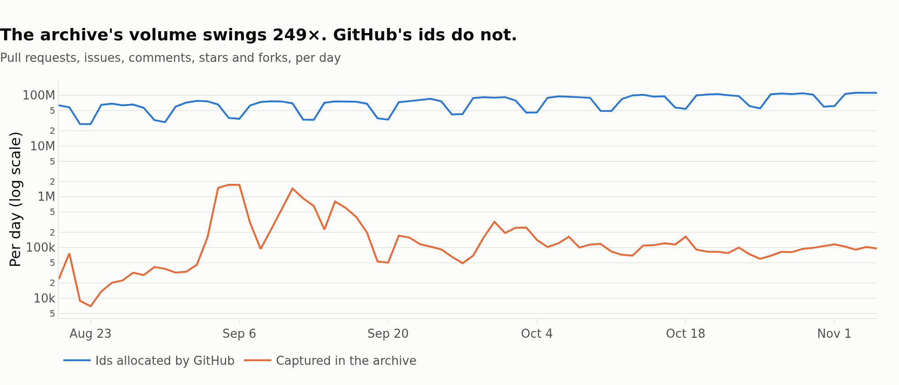
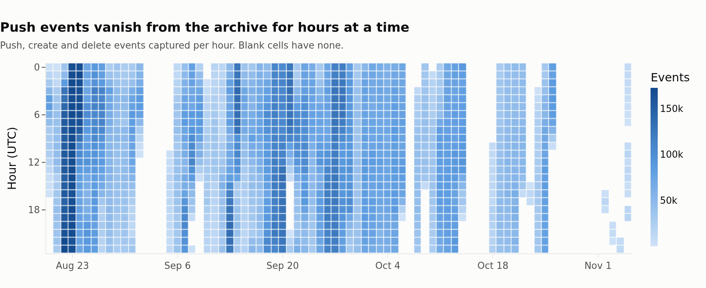
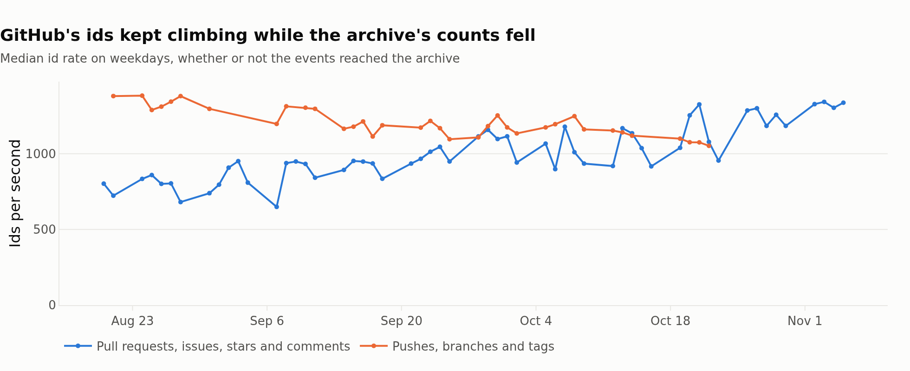
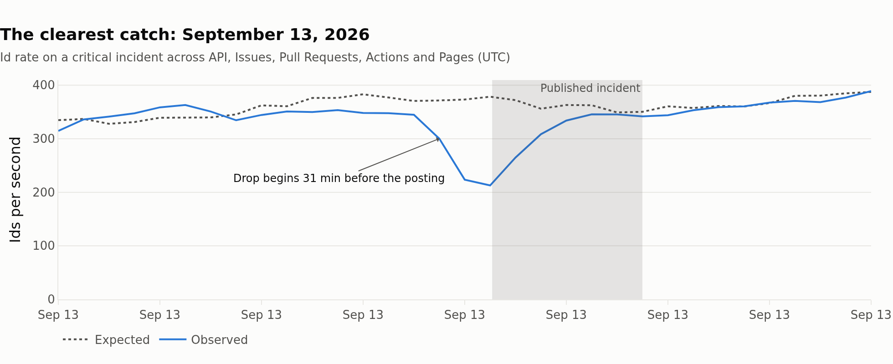

# Findings

78 days of GH Archive (2026-08-20 to 2026-11-05), 107.6M events, scored against 50 incidents from GitHub's status page. The numbers here come from [results.json](results.json), which `python -m eventflow.cli report` regenerates from the warehouse.

## 1. Archive volume tracks the feed, not GitHub

GitHub numbers events from two unrelated sequences, one for pushes, branches and tags (`ref`) and one for pull requests, issues, comments, stars and forks (`collab`). Each id is allocated whether or not the event reaches the archive, so the span of ids in an hour measures activity independently of the feed.

Captured `collab` events range from 6,953 to 1,729,172 a day, a 249× swing, while ids allocated stay within a normal weekly cycle. A chart of raw archive counts over this period would show GitHub activity rising 200× in two weeks and collapsing again. That never happened.

**Capture is a relative index, not a share of public events.** Ids also cover activity that never becomes public, so `events / ids` tops out near 5% even on the best days. It says how one hour compares with another, not what fraction of public events was seen. An early version of this project scaled stars by raw `1 / capture`, which claimed 5.4M stars for one repo in 11 weeks. Normalizing to the best-covered day fixed the scale, and repo-level figures are still used for ranking only, since a single star caught in a thin hour carries a large weight.

**The loss is close to uniform across event types,** which is what makes reweighting legitimate at all. Between the lowest and highest capture bands, a 74× range, stars stay between 6.6% and 7.5% of `collab` events and pull requests between 37.0% and 39.1%.

Reweighting changes results: 7 of the top 20 repos by raw captured stars drop out once stars are scaled by capture, because they peaked during the high-capture weeks of September.

## 2. Pushes vanish for hours and days

The `ref` sequence is absent from 507 of 1,872 hours (27.1%), and is nearly gone after October 26. The hour files still exist and still parse, so a pipeline checking only that files landed would see nothing wrong. Any push-based metric from this period is unusable without masking these hours, which is why `ref_stream_present` is an audit check and why everything downstream that needs full coverage uses `collab`.

## 3. Ids climbed while the archive's counts fell

Weekday `collab` id allocation rose 61%, from 801 to 1,292 ids per second, between the first and last ten usable weekdays. `ref` fell 14%, from 1,312 to 1,130, measured only on days with enough coverage (its last usable day is October 22).

This measures allocation, not necessarily human activity. A new internal use of the sequence would look the same, and I have no way to tell them apart from outside GitHub.

## 4. Id rate is not a general outage detector

The question: does a sustained drop in id rate reveal an incident? The detector compares each 15 minute window to a six hour trailing level with the hour-of-week cycle removed, and flags two consecutive windows below a threshold. An episode matches an incident if it overlaps from an hour before the posting to 30 minutes after resolution. The threshold was chosen on data before October 1 and scored on the rest.

| Period | Episodes | Matched | Incidents | Caught |
|---|---:|---:|---:|---:|
| Train, to Sep 30 | 8 | 2 | 16 | 2 |
| Test, from Oct 1 | 32 | 10 | 34 | 9 |
| Test, critical or major only | 32 | 2 | 13 | 2 |

**It does not work as a general detector.** On held-out data it caught 9 of 34 incidents with 31% precision. Sliding the episodes to random offsets matches 5.4 by chance against the 10 observed (95th percentile 11, p = 0.081), which is not significant. Most incidents hit Actions, Copilot or webhooks, and those failures do not stop GitHub recording events. False alarms include ordinary quiet periods: the deepest early one was the afternoon of US Labor Day.

**It does see outages in the write path.** The two clearest drops, the ones that fell furthest below baseline before a platform incident was posted:

| Drop began (UTC) | Lowest ratio | Incident | Posted |
|---|---:|---|---:|
| Sep 13 08:45 | 0.56 | Several GitHub services, critical | 31 min later |
| Oct 26 18:15 | 0.60 | Actions, Issues, API, Pull Requests, minor | 33 min later |

These are onsets found in hindsight, not early warnings. Confirming a drop takes two 15 minute windows, so a live detector would have fired at about the moment GitHub posted, and the archive publishes with a delay on top of that. Two cases also prove little on their own.

The test set was looked at once with this threshold. The other thresholds are recorded in `results.json` under `test_grid` for reference and were not used to choose anything.

## 5. Stars from week-old accounts

Account ids are issued in order, so the highest id seen by each day dates any account to within a day. 5.6% of 1.21M datable stars came from accounts under a week old. Among the 1,131 repos with at least 100 captured stars, 31 got most of their stars from such accounts. This is a signal to look closer, not proof of manipulation, so no repos are named here.

## 6. Who generates the events

Of `collab` events, 62.1% come from accounts classed as human, 29.4% from bots and 8.5% from known AI agent accounts. The agent share is a lower bound, because an agent acting through a person's account counts as human.

## Limits

- Two months of data, one incident feed, and a status page that only serves its latest 50 entries, so nothing before August 26 can be scored.
- Status page timestamps record when GitHub posted, not when a failure began.
- Id spans are estimated from the 1st to 99th percentile of captured ids, so they get noisier in thin hours.
- A burst of capture can momentarily run ids backwards, as on October 23. The detector discards windows where capture jumps fivefold.
